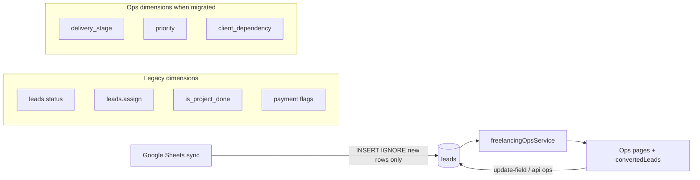
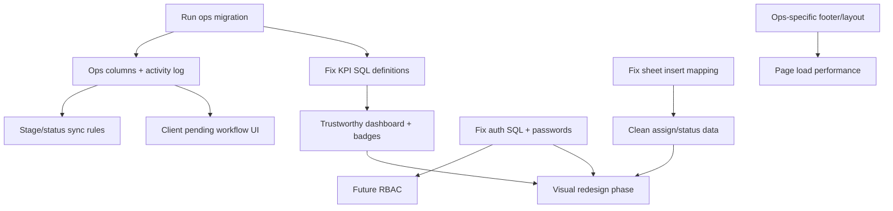

# Freelancing CRM — Enterprise Audit (Phase 0)

**Audit date:** 2026-03-23  
**Scope:** Actual codebase under `/freelancing/*` (ops restructure), shared `leads` data, sheet sync, and legacy pages.  
**Method:** Static review of routes, services, views, migrations, and auth. No code changes in this phase.

---

## 1. Existing architecture overview

### Stack

| Layer | Implementation | Evidence |
|--------|----------------|----------|
| Server | Express router mounted at `/freelancing` | `routes/index.js` → `require('./Freelancing/index')` |
| Views | EJS server-rendered | `routes/Freelancing/ops-pages.js`, `views/freelancing/ops/*` |
| Data | MySQL `mysql2` pool | `routes/pool.js`, `services/freelancingOpsService.js` |
| Source of truth | Single table `leads` (wide row) | All ops queries in `freelancingOpsService.js` |
| Ops logic | Shared service + map utils | `services/freelancingOpsService.js`, `utils/freelancingOpsMap.js`, `utils/freelancingOpsDates.js` |
| JSON API | `/freelancing/api/ops/*` | `routes/Freelancing/ops-api.js` |
| Legacy editing | POST `/freelancing/update-field` | `routes/Freelancing/index.js` → delegates to `updateWorkField` |
| Sheet ingest | Google Sheets → `INSERT IGNORE` | `routes/Freelancing/sheetSyncLeads.js`, GET `/freelancing/sync-leads` |
| Auth | Session `req.session.affiliation` (freelancing user id) | `routes/dataService.js` → `freelanceAuthenticationToken` |
| UI shell | W3CRM template (`views/freelancing/header.ejs`, `footer.ejs`) + thin ops CSS | `public/freelancing/ops/ops.css`, `views/freelancing/ops/partials/layout-*.ejs` |

There is **no separate frontend SPA**, **no ORM**, and **no role/permission model** beyond “logged in to freelancing account.”

### Route map (actual)

| Route | Handler | View / response |
|--------|---------|-----------------|
| `GET /freelancing/` | `index.js` | `freelancing/login` |
| `POST /freelancing/login` | `index.js` + inline auth in `dataService` | redirect or login |
| `GET /freelancing/dashboard` | `ops-pages.js` | `freelancing/ops/dashboard.ejs` |
| `GET /freelancing/priority` | `ops-pages.js` | `freelancing/ops/priority.ejs` |
| `GET /freelancing/delivery` | `ops-pages.js` | `freelancing/ops/delivery.ejs` |
| `GET /freelancing/client-pending` | `ops-pages.js` | `freelancing/ops/client-pending.ejs` |
| `GET /freelancing/team-workload` | `ops-pages.js` | `freelancing/ops/team-workload.ejs` |
| `GET /freelancing/unassigned` | `ops-pages.js` | `freelancing/ops/unassigned.ejs` |
| `GET /freelancing/deadlines` | `ops-pages.js` | `freelancing/ops/deadlines.ejs` |
| `GET /freelancing/finance` | `ops-pages.js` | `freelancing/ops/finance.ejs` |
| `GET /freelancing/analytics` | `ops-pages.js` | `freelancing/ops/analytics.ejs` |
| `GET /freelancing/work/:id` | `ops-pages.js` | `freelancing/ops/work-detail.ejs` |
| `GET /freelancing/convertedleads/:month` | `index.js` | `freelancing/convertedLeads.ejs` (**`:month` = 1–12, not lead id**) |
| `GET /freelancing/leads/:status` | `index.js` | legacy queue views |
| `GET /freelancing/assign/:assign`, `/workload/:assign`, `/profit/yearly` | `index.js` | legacy JSON/HTML |
| `GET /freelancing/sync-leads?mode=daily\|backfill` | `index.js` | calls `syncLeads`, redirect dashboard |
| `POST /freelancing/update-field` | `index.js` | JSON |
| `GET/POST /freelancing/settings` | `index.js` | Rockerstop bot settings |
| `GET /freelancing/api/ops/*` | `ops-api.js` | JSON (same auth as pages) |
| **Separate product** | `routes/Freelancing/sales.js` | Tele-sales on `rockerstop_leads` — out of ops pages but shares auth pattern |

**Note:** Plan referenced `/freelancing/convertedleads/:id`; production route is **`/freelancing/convertedleads/:month`**. Single-record hub is **`/freelancing/work/:id`**.

### Data model (leads + ops extension)

- **Legacy columns:** `status`, `assign`, `deadline`, `is_project_done`, payment flags, prices, `sheet_uid`, etc.
- **Ops extension (optional until migration run):** `migrations/freelancing_ops_workflow.sql` — `priority`, `delivery_stage`, `client_dependency`, blocker/follow-up dates, delivery timestamps, `lead_activity_log`.
- **Runtime detection:** `detectOpsColumns()` in `freelancingOpsService.js` caches whether `delivery_stage` exists; behavior degrades to legacy `status`/`assign` mapping via `deriveDeliveryStage()` in `utils/freelancingOpsMap.js`.

### Lifecycle (conceptual)

**Dual workflow:** UI shows `delivery_stage_effective` (derived or stored) alongside legacy `status`. Sheet sync still maps sheet **AGENT** column into **`status`** (documented in `mapSheetRowToDbLead`), not into `assign` — historical semantic debt.

---

## 2. Route-wise UX problems

Severity: **P2** unless noted.

### Global shell (`header.ejs`, `footer.ejs`, `ops/partials/layout-*`)

| Issue | Evidence | Severity |
|--------|----------|----------|
| **Template soup:** W3CRM demo chrome (chat box, fake profile “Thomas Fleming”, affiliate sidebar links) wraps ops pages | `views/freelancing/header.ejs` (~1.5k lines), Order Management → `/affiliate/dashboard/...` | P2 |
| **Heavy JS on every ops page:** DataTables init, dashboard-1.js, vectormap, demo/styleSwitcher | `views/freelancing/footer.ejs` lines 31–63 | P2 (perf) |
| **Inconsistent visual language:** Ops cards (`ops.css`) vs dark `convertedLeads.ejs` vs legacy `dashboard.ejs` (unused but present) | `views/freelancing/ops/*`, `convertedLeads.ejs`, `dashboard.ejs` | P2 |
| **No global loading skeletons** on ops routes; errors often plain text (`Dashboard error`, `500`) | `ops-pages.js` catch blocks | P2 |
| **Sidebar badge for overdue** not shown in merged nav (only client_pending + unassigned) | `header.ejs` Work & Delivery section vs `getNavBadgeCounts()` returning `overdue` | P3 |

### `/freelancing/dashboard`

| Issue | Evidence |
|--------|----------|
| KPI cards link to filtered routes but **dashboard filters (from/to, agent, q) are not exposed** in UI | `parseFilters` in `ops-pages.js`; dashboard template has no filter toolbar |
| Sync buttons with **no on-page feedback** except query string (not rendered in template) | `dashboard.ejs` sync links; redirect in `index.js` `/sync-leads` |
| Priority table shows **top 10 from first SQL page**, not true global top 10 by score | `getPriorityAttention()` → `listWork` default sort then client sort | P1 UX/trust |

### `/freelancing/priority`

| Issue | Evidence |
|--------|----------|
| Tabs include **blocked / critical** but no explanation when migration off | `priority.ejs`; `listWork` no-ops some views without `hasOps` |
| **No bulk actions**, inline edit, or row actions except Open | `work-table.ejs` |
| Pagination renders **all page buttons** (no ellipsis) | `work-table.ejs` loop `totalPages` |

### `/freelancing/delivery`

| Issue | Evidence |
|--------|----------|
| Kanban loads **up to 500 rows** with duplicate `listWork` call | `ops-pages.js` delivery handler |
| Stage change via `<select>` + confirm; **no drag-drop**; changing stage does not sync legacy `status` | `delivery.ejs`, `ops-common.js` |
| **No empty column guidance** beyond empty cards | `delivery.ejs` |

### `/freelancing/client-pending`

| Issue | Evidence |
|--------|----------|
| **No UI to set/clear** `client_dependency`, `follow_up_due`, or resolve workflow | Read-only table; no forms |
| Tab title promises ops field; without migration falls back to `status = client_review` | `listWork` in service |

### `/freelancing/team-workload`

| Issue | Evidence |
|--------|----------|
| Drill-down only when `?agent=` set; **no link from row except agent name** | `team-workload.ejs` |
| Cap **50 agents** with no “show more” | `getTeamWorkload()` `LIMIT 50` |

### `/freelancing/unassigned`

| Issue | Evidence |
|--------|----------|
| **Urgent count** computed from first 50 active unassigned only, not full set | `ops-pages.js` `urgentList` limit 50 |
| Metrics copy is good but **all_time vs active** differs only by `activeOnly` flag — easy to misread | `unassigned.ejs` |

### `/freelancing/deadlines`

| Issue | Evidence |
|--------|----------|
| **List only** — no calendar/month grid despite plan language | `deadlines.ejs` |
| `limit: 200` single page — no calendar UX | `ops-pages.js` |

### `/freelancing/finance`

| Issue | Evidence |
|--------|----------|
| Pending client/agent lists are **samples from first 50 arbitrary leads**, not dedicated queries | `ops-pages.js` finance handler |
| **No currency formatting**, totals, or export | `finance.ejs` |
| Range KPIs vs snapshot KPIs **not labeled clearly** | `getFinanceSummary` range vs global outstanding |

### `/freelancing/analytics`

| Issue | Evidence |
|--------|----------|
| Charts depend on **CDN Chart.js**; loads after footer CRM scripts | `analytics.ejs` |
| Status distribution uses **`created_at` range**, not operational pipeline | `getStatusDistribution` |
| Legacy full dashboard charts **not removed** from unused `views/freelancing/dashboard.ejs` (confusion for maintainers) | file still in repo |

### `/freelancing/work/:id`

| Issue | Evidence |
|--------|----------|
| **Read-mostly** — priority/stage only; no assign/deadline/finance edits, no client dependency editor | `work-detail.ejs` |
| Priority `<option>` missing `value=` attribute | `work-detail.ejs` line 34 — browser may submit wrong values | **P1** |
| No toast/feedback on `opsPatchField` success/failure | `ops-common.js` |

### `/freelancing/convertedleads/:month`

| Issue | Evidence |
|--------|----------|
| **Different UI theme** (dark) vs ops pages | `convertedLeads.ejs` |
| Inline `contenteditable` updates — powerful but **no validation UX** | `updateField` in template |
| `SELECT *` on leads | `index.js` convertedleads query |
| Default `limit` query 500 clamped to **200 max** | `index.js` lines 529–530 |

---

## 3. Route-wise functional problems

| ID | Issue | Evidence | Severity |
|----|--------|----------|----------|
| F1 | **Sheet sync swaps `assign` and `status` on INSERT** — SQL column order `(status, assign)` but params pass `assign, status` | `sheetSyncLeads.js` `upsertLead` lines 210–229 | **P0** |
| F2 | Sheet maps **AGENT column → `status`**, not agent assignment field | `mapSheetRowToDbLead` comment lines 149–151 | **P1** (semantic / reporting) |
| F3 | **`INSERT IGNORE`** never updates existing rows — ops fields and corrections not synced | `upsertLead` | **P1** |
| F4 | **MySQL `CURDATE()`** used for overdue/KPIs; **urgency labels use IST** in JS | `freelancingOpsService.js` vs `urgencyBucket` + `todayYmdInTz` | **P1** |
| F5 | **`getNavBadgeCounts.client_pending`** counts all rows with dependency ≠ none, **not scoped to `activeWorkSql`** | `getNavBadgeCounts` vs `getExecutiveKpis.awaiting_client` uses active | **P1** (KPI mismatch) |
| F6 | **`payment_pending` KPI** counts all `is_project_done=1 AND is_payment_received=0` **without active/stage filter** | `getExecutiveKpis` | **P2** |
| F7 | **`getPipelineCounts`** may double-count NULL `delivery_stage` into `unassigned` when also grouped | `getPipelineCounts` nullRows + group branch | **P2** |
| F8 | Finance **client/agent pending lists statistically wrong** | `ops-pages.js` finance | **P1** |
| F9 | **No API auth separate from session** — same cookie for HTML and JSON | `ops-api.js` mounted on same router with `freelanceAuthenticationToken` | **P2** |
| F10 | **No CSRF** on POST/PATCH | `update-field`, `ops-api` PATCH | **P1** |
| F11 | **Login SQL injection** | `dataService.js` `freelanceAuthenticationToken` string interpolation | **P0** |
| F12 | **Plaintext password check** | same query on `freelancing` table | **P0** |
| F13 | **Activity log** only if table exists; **no log rollback** if UPDATE succeeds and log fails | `updateWorkField` | **P2** |
| F14 | **`patchWork`** multi-field = sequential updates, not transaction | `patchWork` | **P2** |
| F15 | **Stage transition** does not update legacy `status` / `is_project_done` | `updateWorkField` | **P1** ops confusion |
| F16 | **detectOpsColumns** cached for process lifetime — migration mid-flight needs restart | `_hasOpsColumns` | **P2** |
| F17 | **Middleware DB hit every request** — `getNavBadgeCounts()` on all `/freelancing/*` | `index.js` router.use after auth | **P2** scale |
| F18 | Dashboard **duplicate badge queries** (middleware + handler + `baseLocals`) | `ops-pages.js` dashboard | **P2** |
| F19 | **QuickEditDrawer / bulk assign** from plan — **not implemented** | grep ops views | **P2** gap |
| F20 | **convertedleads** and **ops** use different edit paths; both hit same service but **convertedLeads bypasses stage rules** for `status` only | `LEGACY_ALLOWED` includes `status` without transition rules | **P1** |

---

## 4. Data integrity risks

| Risk | Detail | Severity |
|------|--------|----------|
| Dual workflow without sync | `delivery_stage`, `priority`, `client_dependency` vs `status`, `assign`, `is_project_done` can disagree | **P0** operational |
| Migration optional at runtime | Production may run **without** migration; UI partially works with derived stages only | **P1** |
| Sheet → DB column swap (F1) | New synced rows can have **inverted assign/status** | **P0** |
| AGENT in `status` | Reports/filters on `status` mix workflow state and person names | **P1** |
| Financial fields as loose numerics | No cents integer, no currency; `lead_price - advance_amount` can go negative without guard | **P1** |
| No FK on `lead_activity_log.lead_id` | Orphan log rows possible if leads deleted | **P2** |
| `lead_id` type INT vs BIGINT in log table | Possible overflow mismatch on large ids | **P3** |

---

## 5. Security and scalability risks

### Security

| Item | Evidence | Severity |
|------|----------|----------|
| SQL injection on freelancing login | `dataService.js` | **P0** |
| Shared session id only — **no RBAC**, finance same as ops | `freelanceAuthenticationToken` | **P1** |
| **Secrets in repo** — Cloudinary config in `routes/Freelancing/index.js` | lines 24–27 | **P0** if repo is shared |
| API endpoints expose full work row to any authenticated user | `ops-api.js` GET `/work/:id` | **P1** |
| No rate limiting on sync or update-field | `/sync-leads`, `/update-field` | **P2** |

### Scalability (design targets — **requires load testing**)

| Concern | Code behavior | Assessment |
|---------|---------------|------------|
| 10k+ historical rows | Indexed ops columns in migration; convertedleads uses `SELECT *` | List ops OK with pagination; month view heavy |
| Hundreds active tasks | Kanban cap 500; multiple COUNT(*) on full table | **Needs load test** on KPI/badge queries |
| Concurrent staff | Single shared login model; no row locking | **Last write wins** on `update-field` |
| Badge middleware per request | Full table aggregates | **Hot path** at scale |

---

## 6. Reusable components worth preserving

| Asset | Why keep |
|--------|----------|
| `services/freelancingOpsService.js` | Single place for queue SQL, KPIs, updates, activity log |
| `utils/freelancingOpsMap.js` | Stage derivation, active work, urgency, transitions |
| `utils/freelancingOpsDates.js` | IST-aware date helpers (extend to SQL boundary) |
| `migrations/freelancing_ops_workflow.sql` | Clear backward-compatible schema |
| `routes/Freelancing/ops-api.js` | Foundation for SPA/drawer later |
| `views/freelancing/ops/partials/work-table.ejs`, `filter-toolbar.ejs` | Repeatable list pattern |
| `public/freelancing/ops/ops-common.js` | Stage patch helper |
| `scripts/test-freelancing-ops.js` | Map/unit tests (expand to service) |
| `scripts/backfill-leads-delivery-stage.js` | Idempotent stage backfill |
| POST `/freelancing/update-field` delegation | Backward compatibility with `convertedLeads.ejs` |

---

## 7. Missing enterprise functionality

- Role-based access (finance-only, team lead, read-only)
- Agent master / capacity (plan noted DISTINCT assign only)
- Bulk assign, bulk priority/deadline
- Client pending resolve workflow + restore stage
- Quick-edit drawer / consistent edit surface on work detail
- CSRF + input validation layer (types, enums, money)
- Audit log for all paths (including convertedLeads inline edits — partial today)
- Sync **update** strategy (not only INSERT IGNORE) with owner-approved mapping
- Notification / assignment alerts
- Export on finance and ops lists
- True deadline calendar
- Empty/error/loading states per route
- Integration tests against test DB
- Cron monitoring for sheet sync (cron file exists; not verified enabled in this audit)
- Separation of freelancing nav from affiliate demo links in sidebar

---

## 8. Prioritized recommendations

### P0 — Data integrity or critical operational risk

1. **Fix `upsertLead` param order** (`status` vs `assign`) in `sheetSyncLeads.js`.
2. **Run and enforce** `migrations/freelancing_ops_workflow.sql` in all environments; add deployment check.
3. **Document and reconcile** sheet AGENT → `status` mapping; stop swapping assign/status on insert.
4. **Fix SQL injection + password storage** on freelancing login (`dataService.js`).
5. **Align KPI/badge SQL** to one definition of “active”, “client pending”, and **IST vs CURDATE** for deadlines.
6. **Define single write model:** stage change updates legacy fields or UI shows both with explicit sync rules.

### P1 — Major workflow or reliability

1. Fix **work-detail priority select** (`value` attributes) and add user feedback on saves.
2. Replace finance **sample lists** with proper filtered queries + pagination.
3. Fix **getPriorityAttention** to score across full active set (SQL ORDER BY or dedicated query).
4. Implement **client-pending actions** (dependency, follow-up, resolve).
5. Add **CSRF** tokens to forms and JSON POSTs.
6. **Trim footer scripts** on ops routes (ops-specific layout footer).
7. **Remove or gate affiliate sidebar links** on freelancing header for coherent nav.
8. **Transaction-wrap** multi-field patches + activity log.

### P2 — UI/UX and productivity

1. Unified design system (one shell, one table density, shared tokens).
2. Dashboard filters + sync result banner.
3. Kanban pagination/virtualization; table view default for large queues.
4. Bulk actions on priority/unassigned.
5. Calendar on deadlines.
6. Cache badge counts with TTL; remove duplicate fetches on dashboard.
7. Loading and error partials.
8. Delete or archive unused `views/freelancing/dashboard.ejs` monolith.

### P3 — Optional enhancement

1. Drag-drop kanban, QuickEdit drawer, agent capacity chart.
2. Overdue badge in sidebar.
3. Export CSV on all list pages.

---

## 9. Dependencies between improvements

**Critical path before visual redesign:** migration applied → P0 data/sync fixes → KPI/timezone consistency → auth hardening → finance/priority query correctness → slim CRM shell (nav + scripts).

---

## 10. Safe implementation strategy

1. **Phase A — Truth in data (no UI paint):** Migration, sync param fix, backfill script, KPI SQL alignment, IST boundary tests.
2. **Phase B — Safety:** Parameterized login, CSRF, validate `updateWorkField` types; optional transaction wrapper.
3. **Phase C — Workflow completeness:** Work detail editors, client-pending actions, stage/status sync policy documented in code.
4. **Phase D — Shell cleanup:** Freelancing-only sidebar partial; ops layout footer without DataTables/demo JS.
5. **Phase E — UX polish / redesign:** Visual system, drawers, bulk ops, calendar.
6. **Verification:** Extend `scripts/test-freelancing-ops.js`; add integration tests for `listWork`, KPI counts; manual smoke checklist per route; **load test** badge + KPI queries with realistic row counts.

Each phase shippable behind feature flags or env checks (`detectOpsColumns` already patterns this).

---

## Appendix A — Enterprise readiness checklist

| Target | Current state | Gap |
|--------|---------------|-----|
| 10k+ historical records | Pagination on ops lists; convertedleads `SELECT *` | Month view + unindexed filters need review |
| Hundreds active tasks | 500 kanban cap | Incomplete board above cap |
| Multiple staff | One session per freelancing account | No per-user actors (only `user:{affiliation}`) |
| Multiple project types | `enquiry` text only | No normalized project type |
| Team leads / agents | `assign` free text | No agent table |
| Finance-only users | Not supported | Same auth |
| Role-specific access | Not supported | **P0** for enterprise |
| Frequent status changes | update-field works | No optimistic locking |

**Load testing recommended for:** `getExecutiveKpis`, `getNavBadgeCounts`, `getTeamWorkload`, delivery kanban `listWork(limit:500)`, middleware on every request.

---

## Appendix B — Testing evidence today

- `scripts/test-freelancing-ops.js` — unit tests on **map utils only** (7 cases); no service/HTTP/DB integration tests documented in CI.

---

*End of audit. No application code was modified in Phase 0.*
